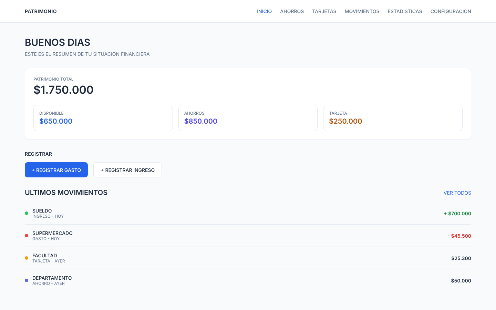

# Patrimonio

Sitio web para llevar el control del patrimonio personal: dinero disponible, ahorros por objetivo, tarjetas de crédito, movimientos diarios y estadísticas.

Proyecto de la cátedra **Programación 4** — Universidad Champagnat (Prof. Lic. Ignacio G. Fontaine Digier).
Entrega: **Ejercitación 3.1 — Del diseño al código**.

## Integrantes

- Lautaro Espejo

## Enlaces

- 🌐 Sitio publicado: [COMPLETAR con el enlace de GitHub Pages o Netlify]
- 🎨 Prototipo en Figma: https://www.figma.com/design/mAGqEaUlhmfvLpwQLg1DWA/Design-System-Patrimonio

## ¿Qué problema resuelve?

Las personas con ingresos propios necesitan comprender cuánto dinero tienen **realmente disponible para gastar**, pero hoy administran sus finanzas con aplicaciones bancarias, tarjetas de crédito, Excel, notas o registros manuales. Esa fragmentación, sumada a los gastos pequeños y a los compromisos de tarjeta, hace difícil tener una visión clara de su situación económica.

**Patrimonio** centraliza esa información y diferencia el dinero *disponible* del dinero *ahorrado* y del dinero *comprometido con tarjetas*: **Patrimonio total = disponible + ahorros + reserva de tarjeta**.

**Usuario objetivo (User Persona):** Pedro, 25-34 años, con ingresos propios y una o más tarjetas de crédito. *"Quiero saber cuánto puedo gastar realmente sin tener que estar revisando y organizando todo constantemente."*



## Pantallas construidas

| Pantalla | Archivo | Qué permite |
|---|---|---|
| Iniciar sesión | `index.html` | Entrar a la cuenta (validación por campo) |
| Crear cuenta | `crear-cuenta.html` | Registro con validación de correo y contraseña |
| Recuperar contraseña | `recuperar-contrasena.html` | Pedir instrucciones por correo |
| Inicio | `inicio.html` | Resumen del patrimonio y registro de gastos/ingresos (paneles laterales) |
| Ahorros | `ahorros.html` | Objetivos de ahorro con barra de progreso |
| Tarjetas | `tarjetas.html` | Tarjetas, períodos e historial filtrable |
| Movimientos | `movimientos.html` | Listado con filtros por tipo y búsqueda en tiempo real |
| Estadísticas | `estadisticas.html` | Gráficos de ingresos, gastos y distribución |
| Configuración | `configuracion.html` | Datos de la cuenta y cierre de sesión |

## Cómo cumple cada etapa de la consigna

**1. Estructurar (HTML semántico).** `header`, `nav`, `main`, `section`, `article` y `footer`; un único `h1` por página con títulos en orden; menú de navegación entre pantallas; formularios con `label` asociado y tipos de input correctos (`email`, `password`, `number`, `date`); enlace "Saltar al contenido" para teclado.

**2. Diseñar (CSS).** Paleta y tipografía del prototipo definidas como variables en `:root`; maquetación con Flexbox y Grid; responsive con `@media` (breakpoint en 768 px, menú hamburguesa en celular); estados `:hover` y `:focus-visible` en enlaces, botones y campos; transiciones suaves y componentes reutilizables (`.btn`, `.badge`, tarjetas, paneles, modales).

**3. Dar vida (JavaScript).**
- Validación de formularios con un mensaje de error junto a cada campo (`js/validacion.js`).
- Menú hamburguesa que se abre y se cierra en mobile, también con la tecla Esc (`js/menu.js`).
- Filtro por tipo y búsqueda en tiempo real en Movimientos; filtros por tarjeta y estado en el historial de Tarjetas.
- Paneles laterales y modales de confirmación.

**4. Verificar.** Ver la sección siguiente.

**5. Publicar.** Repositorio en GitHub + sitio en GitHub Pages / Netlify (enlace arriba).

## Verificación de accesibilidad (Lighthouse)

Se ejecutó Lighthouse en las 9 pantallas antes y después de las correcciones.

| Pantalla | Accesibilidad antes → después | Buenas prácticas antes → después |
|---|---|---|
| Iniciar sesión | 100 → 100 | 96 → 100 |
| Crear cuenta | 100 → 100 | 96 → 100 |
| Recuperar contraseña | 100 → 100 | 96 → 100 |
| Inicio | 93 → 100 | 96 → 100 |
| Ahorros | 92 → 100 | 96 → 100 |
| Tarjetas | 84 → 100 | 96 → 100 |
| Movimientos | 91 → 100 | 96 → 100 |
| Estadísticas | 95 → 100 | 96 → 100 |
| Configuración | 91 → 100 | 96 → 100 |

**Correcciones aplicadas (y su justificación desde la experiencia de usuario)**

- **Contraste de color.** Los verdes, ámbar y violeta del prototipo no llegaban a la relación 4.5:1 que pide WCAG AA cuando se usan como *texto* (por ejemplo, el ámbar sobre blanco medía 2.15:1). Se agregaron variantes más oscuras solo para texto (`--color-tarjeta-texto`, `--color-ingreso-texto`, etc.); los puntos, barras y gráficos conservan los colores originales del prototipo.
- **Foco visible con teclado.** Se recorrió todo el sitio con Tab: todos los elementos interactivos son alcanzables y se ve el foco. Los paneles laterales cerrados dejaron de recibir foco (antes el cursor "desaparecía" en campos invisibles).
- **Menú en celular.** El menú de 6 enlaces ocupaba casi 130 px del alto de la pantalla en mobile; ahora es un menú hamburguesa.
- **Errores de formulario.** El login no mostraba el mensaje propio porque el navegador interceptaba el envío; ahora cada campo muestra su error al lado y el foco va al primero con problema.
- **Filtros de Tarjetas en celular.** Los dos selectores desbordaban la pantalla; ahora pasan a la línea siguiente.
- **Etiquetas faltantes.** Se agregaron nombres accesibles a los selectores y al buscador.

## Estructura de carpetas

```
patrimonio-web/
├── index.html            (Iniciar sesión)
├── inicio.html, ahorros.html, tarjetas.html, movimientos.html,
│   estadisticas.html, configuracion.html,
│   crear-cuenta.html, recuperar-contrasena.html
├── css/estilos.css
├── js/                   (un archivo por pantalla + menu.js + validacion.js)
├── img/
└── README.md
```

## Tecnologías

HTML5, CSS3 y JavaScript puros. Sin frameworks ni librerías, como pide la consigna.

## Cómo verlo en tu computadora

Abrí la carpeta en VS Code y ejecutá **Live Server** sobre `index.html`, o abrí `index.html` directamente en el navegador.

## Estado del proyecto

Esta entrega corresponde al frontend con datos de ejemplo. Los siguientes pasos son conectar un backend con base de datos para que las pantallas trabajen con datos reales.

## Evaluación y correcciones

Se hizo una evaluación heurística (criterios de usabilidad de Nielsen) sobre el sitio construido. Hallazgo principal: al registrar un gasto o un ingreso en Inicio no había ninguna respuesta visible. Corrección: ahora se valida el monto, se actualizan Disponible y Patrimonio, se agrega el movimiento a la lista y se confirma con un mensaje.
